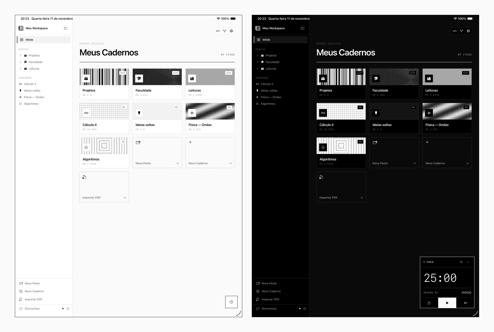
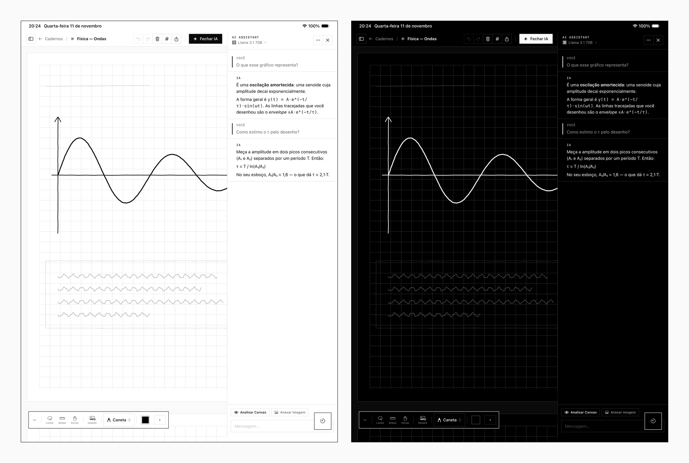

  <picture>
    <source media="(prefers-color-scheme: dark)" srcset="./.github/src/logo-dark.png">
    
  </picture>
  <h1>AI Canvas</h1>
  
<code>HANDWRITING × AI — FOR IPAD</code>

---

## About

**AI Canvas** is an open-source digital notebook for the **iPad** that bridges the natural Apple Pencil handwriting experience with the power of multimodal AI.

The interface is deliberately quiet: square edges, 1pt hairlines, a strictly monochrome palette and monospaced labels. No gradients, no shadows, no color competing with your notes — the only color on screen is the ink you choose. Organize notebooks into folders, write on infinite A4-segmented canvases, and ask an AI that can actually *see* what you drew.

  

## Key Features

* **Native handwriting:** Low-latency PencilKit canvas tuned for iPad and Apple Pencil, with pens, pencil, marker, fountain pen, watercolor, crayon, lasso, ruler and palm rejection.
* **Monochrome design system:** A flat, square, black-and-white interface that adapts to light and dark mode and keeps the focus on your content.
* **Multimodal AI panel:** A side panel that reads your canvas (or just a selection) and helps you:
    * Solve math and engineering problems from hand-drawn formulas.
    * Summarize handwritten or typed notes.
    * Explain concepts and add context directly from your sketches.
* **Bring your own AI:** API keys stored securely in the Keychain. Supported providers:
    * **Google Gemini** (vision)
    * **OpenAI** (vision)
    * **Anthropic Claude** (vision)
    * **Groq** (fast text inference)
* **Infinite workspace:** A scrollable canvas split into A4 pages, with blank, lined or grid backgrounds.
* **PDF import & annotation:** Bring in PDFs, highlight and draw on top of them.
* **PDF export:** Export the canvas with its background pattern for easy sharing.
* **Folders & graph view:** Nest notebooks in folders and explore how everything connects in an interactive node graph.
* **Pomodoro timer:** A floating focus timer that stays on top of every screen.
* **Home Screen widgets:** Recent notebooks, quick new notebook and Pomodoro status.
* **Self-hosted sync:** Optional sync to your own server, with Markdown export to Obsidian and Notion — see [SYNC.md](./SYNC.md).
* **Português & English:** In-app language switch, independent of the system language.

  

## Tech Stack

* **Frontend:** Swift, SwiftUI, PencilKit, WidgetKit
* **AI providers:** Gemini, OpenAI, Claude and Groq APIs
* **Persistence:** Local file system (JSON) for notebooks, Apple Keychain for API keys
* **Architecture:** Modern Swift concurrency with a modular design

## Getting Started

1. Clone the repository: `git clone https://github.com/lucaspanzera1/ai-canvas.git`
2. Open `AICanvas.xcodeproj` in Xcode (requires Xcode 15+ and iPadOS 17+).
3. Build and run on an iPad simulator or a physical iPad.
4. On first launch, follow the onboarding to add your preferred AI API keys.

## Contributing

Contributions are welcome — feel free to open issues or pull requests.

---

Built by [Lucas Panzera](https://github.com/lucaspanzera1)
